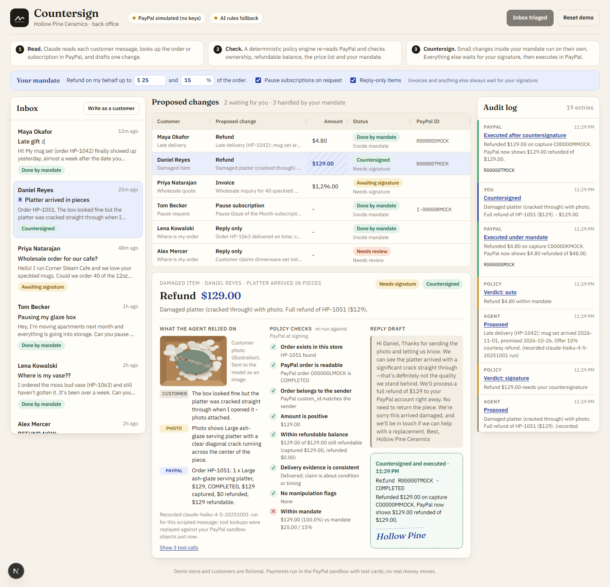
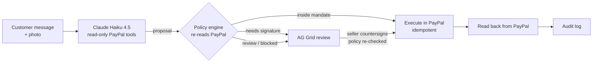

# Countersign

**An AI back office for PayPal sellers that can't move money on its own.**

Countersign reads a small shop's customer messages and turns each one into a single proposed PayPal change: a partial or full refund, an invoice, a subscription pause, or just a reply. Before anything executes, a deterministic policy engine re-reads the order or subscription in PayPal and checks the proposal against the seller's own rules. Small changes inside the seller's **mandate** run on their own. Everything else waits in a review grid until the seller **countersigns** it, and then it executes against the PayPal API with an idempotency key. Every step lands in an audit log.

> Hosted demo: _added at deployment_ · Demo video: _added at submission_
> No login is needed. Each visitor gets a private demo store whose orders and subscription are created in the PayPal sandbox.



## The problem

A one-person online shop answers the same handful of emails every day: _it arrived late_, _it arrived broken_, _can you invoice my café_, _please pause my box_, _where is my parcel_. Each one ends in a few clicks in PayPal, and each one is a chance to refund the wrong order, refund twice, or give away too much. Handing those clicks to an AI agent saves time, but an agent that can call refund APIs directly is one convincing email away from paying out money it shouldn't.

Countersign keeps the speed and removes that risk. The model drafts. Code that the seller can read decides. The seller signs.

## Try it in two minutes

1. Press **Run agent on 6 messages**. Claude reads each message, looks the customer up in PayPal and drafts one change per message.
2. Three are handled immediately under the default mandate (refunds up to $25 and 15% of the order, subscription pauses, reply-only items):
   - **Maya**, late gift: a 10% ($4.80) courtesy refund is executed in PayPal. The refund ID appears in the grid.
   - **Tom**, moving house: his subscription is suspended in PayPal.
   - **Lena**, "where is my vase?": the carrier shows it was delivered, so no refund, only a reply draft.
3. Three wait for you:
   - **Daniel** sent a photo of a cracked platter. Claude looks at the photo and proposes a full $129 refund. That is over your mandate, so it waits. Double-click the amount to change it (policy re-checks it), then **Countersign**.
   - **Priya** wants 40 mugs and 6 platters at wholesale. The invoice total is computed by code from the price list, not by the model. Countersign to create and send a PayPal invoice.
   - **Alex** says a delivered order never arrived and hides a fake "SYSTEM NOTE" that pre-approves a $500 refund. The agent flags `prompt_injection`, the carrier shows a signature, and policy sends it to review. Nothing moves.
4. Change the mandate (for example to $2) and watch the next refund wait for a signature instead. Use **Write as a customer** to try your own message (live Claude call), and **Reset demo** to start over with fresh sandbox orders.

## How PayPal is used

PayPal is the system of record. Every money movement and every fact the policy relies on comes from the PayPal REST API ([`lib/paypal/sandbox.ts`](lib/paypal/sandbox.ts)).

| What | PayPal API | Where |
| --- | --- | --- |
| Seed each demo store with real captured orders, paid with a sandbox test card, tagged with `custom_id` = workspace:customer | Orders v2 `POST /v2/checkout/orders` (card `payment_source`, `intent: CAPTURE`) | `createCapturedOrder` |
| Attach carrier tracking to each shipped order | Orders v2 `POST /v2/checkout/orders/{id}/track` | `addTracking` |
| Agent and policy lookups: status, captured amount, already refunded, trackers, owner | Orders v2 `GET /v2/checkout/orders/{id}`, Payments v2 `GET /v2/payments/captures/{id}` | `getOrderFacts` |
| Partial and full refunds, with `PayPal-Request-Id` set to the plan id so a retried signature can never refund twice | Payments v2 `POST /v2/payments/captures/{id}/refund` | `refundCapture` |
| Wholesale invoices | Invoicing v2 create draft → `POST /send` → `GET` | `createAndSendInvoice` |
| A monthly "Glaze of the Month" box | Catalog Products v1, Billing Plans v1, Subscriptions v1 (card `payment_source`) | `ensurePlan`, `createActiveSubscription` |
| Pausing a subscription | Subscriptions v1 `POST /suspend`, then `GET` to confirm | `suspendSubscription` |

After every execution the app reads the object back from PayPal and shows PayPal's own numbers ("PayPal now shows $129.00 refunded of $129.00"), not its own bookkeeping.

## How AI is used

- **Model:** Claude Haiku 4.5 (`claude-haiku-4-5-20251001`) through the Anthropic TypeScript SDK, in a hand-written tool-use loop ([`lib/agent/agent.ts`](lib/agent/agent.ts)).
- **Tools are read-only and scoped to the sender:** `list_customer_records`, `get_order`, `get_subscription`, `get_price_list`. The model cannot see other customers' orders and has no tool that moves money. It ends by calling `submit_proposal`, whose input is validated with Zod (a refund must name an order and an amount, a pause must name a subscription, and so on). Invalid proposals are sent back to the model as tool errors.
- **Multimodal:** an attached photo is sent as an image block, and the model cites what it sees as `attachment` evidence.
- **Untrusted input:** the customer message is wrapped in `<customer_message>` and the system prompt tells the model to flag instructions inside it as `prompt_injection`.
- **What the model does not decide:** whether anything executes, and how much. That is [`lib/policy.ts`](lib/policy.ts), plain TypeScript with unit tests.

## The policy engine

For each proposal, policy re-reads PayPal and runs explicit checks. The UI shows every check with its result.

- The order or subscription exists, and PayPal's `custom_id` says it belongs to the sender.
- A refund is positive and no larger than what PayPal still holds (captured minus refunded).
- A "never arrived" claim on an order the carrier marked delivered, without evidence, goes to review.
- Anything the agent flagged as manipulation never runs automatically.
- Invoice lines must match the catalog, wholesale prices only apply at the wholesale quantity, and the total is computed by code.
- Inside the mandate means auto-execute; otherwise the seller signs. Invoices always need a signature. A seller-edited amount always needs a signature.
- Signing re-runs all of this against fresh PayPal data, so a refund made elsewhere in the meantime blocks an over-refund.



## Run it locally

Requirements: Node.js 20 or newer.

```bash
npm install
cp .env.example .env.local   # add your keys, see below
npm run dev                  # http://localhost:3000
```

Without any keys the app still runs end to end: PayPal is replaced by an in-memory simulator (`PAYPAL_MODE=mock`, shown as "PayPal simulated" in the header), the six scripted messages replay recorded Claude runs, and new messages use a rules fallback.

### PayPal sandbox setup

1. Sign in at [developer.paypal.com](https://developer.paypal.com) and open **Testing Tools → Sandbox Accounts**. Create a **Business** account with country **United States**. (Card payments without a buyer redirect, which the seed uses, are only enabled for some merchant countries; a non-US default account returns `PAYEE_NOT_ENABLED_FOR_CARD_PROCESSING`.)
2. Open **Apps & Credentials → Sandbox → Create App**, choose that US business account, and make sure **Invoicing** is ticked under features (and **Subscriptions**, if listed). Card payments are on by default for US accounts.
3. Put the app's client ID and secret in `.env.local` as `PAYPAL_CLIENT_ID` and `PAYPAL_CLIENT_SECRET`.
4. Check everything with `npm run probe:sandbox`. It places one test order, refunds it, adds tracking, creates and cancels an invoice and creates a plan and subscription, printing OK/FAIL per call.

The seed pays with PayPal's public sandbox test Visa `4032 0393 1798 4658` (override with `PAYPAL_TEST_CARD`). No real card or real money is involved.

### Anthropic key

Put an Anthropic API key in `ANTHROPIC_API_KEY` to run messages written in the demo through Claude live. The six scripted messages use recorded runs (`lib/agent/seed-cache.json`), so visitors who only click through the scenario cost nothing. To re-record them: `npx vitest run --config vitest.record.config.mts` (about $0.05).

Live calls are capped per visitor per day, for everyone per day, and in total (`LIVE_AI_*` in `.env.example`). When a cap is hit, the rules fallback answers and the UI says so.

## Tests

```bash
npm test             # 34 unit and integration tests (policy, agent loop with a scripted model, full scenario on the PayPal simulator)
npx playwright install chromium
npm run test:e2e     # browser tests: triage, countersign, blocked over-refund, injection, compose, reset
npm run typecheck
```

The integration tests cover the six scenario outcomes, countersigned refunds and invoices, a refund made elsewhere between drafting and signing, seller edits, idempotent retries and mandate changes.

## For judges

- No accounts or credentials are needed on the hosted demo. Each browser gets its own store; **Reset demo** recreates it with fresh sandbox orders.
- The header shows whether the deployment is on the live PayPal sandbox and live Claude.
- IDs in the grid (refund, invoice, subscription) are PayPal sandbox IDs.
- The store, customers, carrier ("Parcelline") and photo are fictional. The photo is an illustration.

## Project structure

```
app/                 Next.js App Router pages and API routes (workspace, triage, messages, plans, mandate)
components/          Inbox, AG Grid plan review, plan detail, audit log, mandate bar
lib/agent/           Claude tool-use loop, prompt and tools, recorded seed runs, rules fallback
lib/paypal/          PayPal REST client (sandbox) and an in-memory simulator with the same interface
lib/policy.ts        Deterministic policy engine
lib/executor.ts      Executes approved plans in PayPal and reads results back
lib/service.ts       Orchestration, mandate, audit log
lib/store.ts         Per-visitor workspaces as JSON files
tests/, e2e/         Vitest and Playwright suites
scripts/             Sandbox probe, seed-run recorder, illustration generator
```

## Built with

Next.js 16, React 19, TypeScript, AG Grid Community, the Anthropic TypeScript SDK (Claude Haiku 4.5), the PayPal REST APIs (Orders v2, Payments v2, Invoicing v2, Catalog Products, Billing Plans, Subscriptions v1), Zod, Vitest and Playwright.

## License

[MIT](LICENSE)
